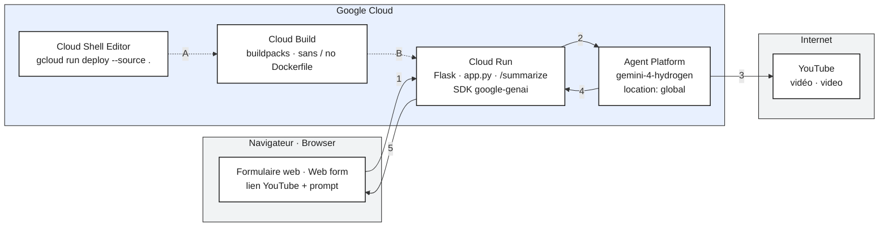
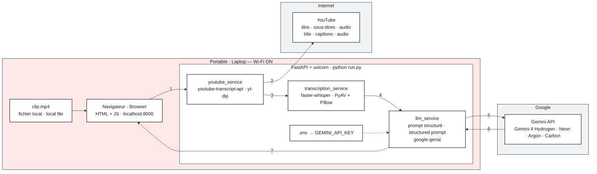
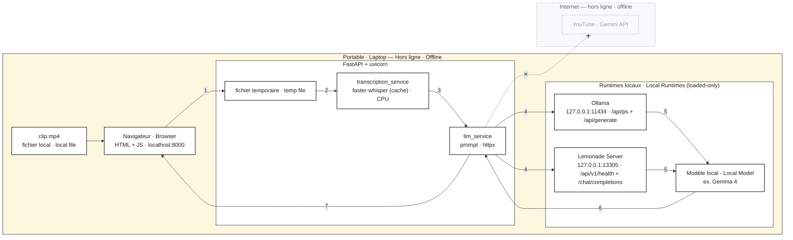
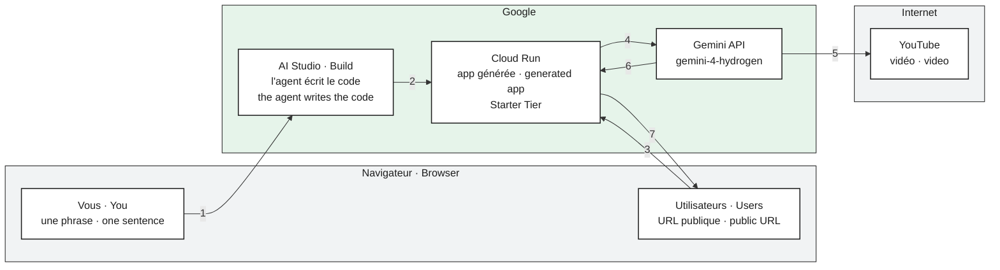
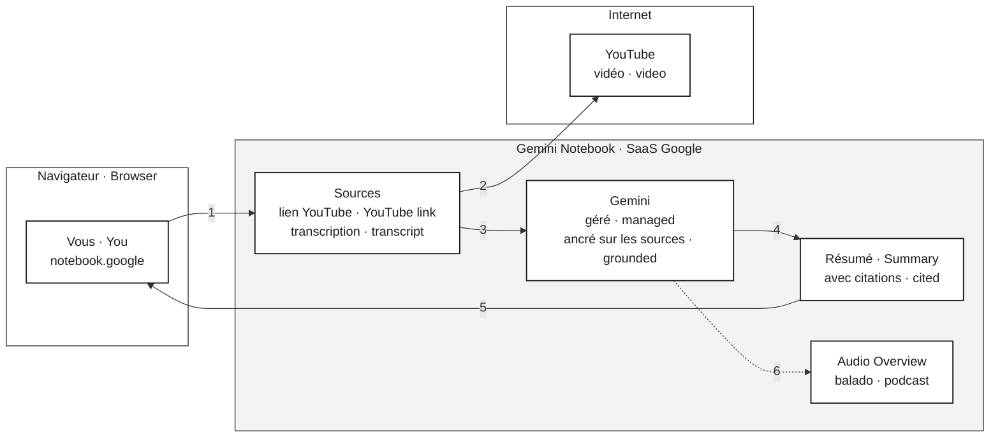

# 📊 Prompt. Build. Ship. — Talk Slides / Diapositives de la conférence

> **Cinq façons de bâtir un outil de synthèse YouTube avec Gemini et plus.**
> **Five Ways to Build a Gemini-Powered YouTube Summarizer and More.**
>
> - **Conférence / Event :** `{ GDG } Ottawa 2026` — **GDG Ottawa · Learn, Build & Jingle** — 15 décembre 2026 / December 15, 2026 · En ligne / Online
> - **Conférencier / Speaker :** Stacy Véronneau
> - **Version :** Release 19 (`2026-11-27 10:15`)
> - **Code (Façons 2 & 3 / Ways 2 & 3) :** [README.md](./README.md)
> - **Architecture :** un diagramme par façon, sous les diapositives 10, 13, 15, 18 et 20 / one diagram per way, under slides 10, 13, 15, 18 and 20

---

## Slide 1 — Prompt. Build. Ship.

**Cinq façons de bâtir un outil de synthèse YouTube avec Gemini et plus.**
*Five Ways to Build a Gemini-Powered YouTube Summarizer and More.*

- **Date :** 15 décembre 2026 / December 15, 2026 · En ligne / Online
- **Conférencier / Speaker :** Stacy Véronneau
- **Présenté au / Presented at :** `{ GDG } Ottawa 2026` · **Learn, Build & Jingle**
- **Version :** Release 19 (`2026-11-27 10:15`)
- **Mention d'IA :** Claude et Gemini ont été utilisés pour générer cette présentation.
- **AI Disclosure:** Claude and Gemini were used to generate this presentation.

---

## Slide 2 — Au menu / On the menu

*À peu près dans cet ordre. À peu près.* / *Roughly in this order. Roughly.*

| Section (FR) | Détails (FR) | Section (EN) | Details (EN) |
|---|---|---|---|
| **Intro** | Qui parle et pourquoi écouter (un peu) | **Intro** | Who's talking and why you should (kinda) listen |
| **Une tâche, cinq façons** | Cloud, local, local sans Wi-Fi, SaaS, zéro code | **One task, five ways** | Cloud, local, local offline, SaaS, zero code |
| **Alors, on code ou pas?** | *Prompt. Build. Ship* — quelle approche, quand, et la suite | **So, build it or not?** | *Prompt. Build. Ship* — when each approach wins, and what's next |

---

## Slide 3 — Pourquoi moi? / Why me?

**Stacy Véronneau**
- **FR :** Conseiller principal en solutions techniques et ambassadeur Google Cloud (Infra · Sécurité) @ TELUS Numérique. *Survivant de la bulle Dot-com, de la Grande Migration infonuagique et d'une installation d'OS sur 20+ disquettes.*
- **EN :** Senior Technical Solutions Advisor & Google Cloud Ambassador (Infra · Security) @ TELUS Digital. *Survivor of the Dot-com Bubble, the Great Cloud Migration, and 20+ floppy-disk OS installs.*

| Période / Era | Parcours (FR) | Journey (EN) |
|---|---|---|
| **Milieu '80 · Mid-80s** | Accro à la techno | Hooked on tech |
| **1995** | Pro en TI : infra, sécurité, DevOps/Platform Engineering | Pro in tech: Infra, Security, DevOps/Platform Engineering |
| **2006** | Premiers pas dans le cloud (S3 + EC2, c'est tout) | Playing in the cloud (S3 + EC2, that was it) |
| **2018** | Évangéliste Google Cloud | Google Cloud Advocate |
| **Oct. 2020** | Organisateur, GDG Cloud Montréal | Organizer, GDG Cloud Montréal |
| **2022** | Accro à l'IA générative | GenAI addict |
| **2026** | GDE (Cloud) et mentor GDG (Est du Canada) | GDE (Cloud) & GDG Mentor (Eastern Canada) |

---

## Slide 4 — UNE TÂCHE. CINQ FAÇONS. / ONE TASK. FIVE WAYS.

- **FR :** Même vidéo. Même prompt. Choisissez votre niveau de paresse.
- **EN :** Same video. Same prompt. Pick your level of laziness.

---

## Slide 5 — Même tâche. Cinq façons. / Same task. Five ways.

*Un lien entre, un résumé sort. Le reste? À vous de voir.* / *Link in, summary out. The rest? Your call.*

**Pipeline :** `Lien · Link (YouTube)` → `App (votre choix · your call)` → `Modèle · Model (Gemini · Gemma)` → `Résumé · Summary (texte · text)`

| # | Façon (FR) | Way (EN) | Stack |
|---|---|---|---|
| **1** | Tout dans Google Cloud | All-in on Google Cloud | Cloud Shell Editor · Cloud Run · Gemini |
| **2** | En local + API Gemini | Local + Gemini API | Antigravity · FastAPI · Gemini API |
| **3** | En local + Gemma 4, sans Wi-Fi | Local + Gemma 4, no Wi-Fi | Antigravity · FastAPI · Ollama · Gemma 4 |
| **4** | SaaS à fond. Let's go! | Full SaaS. Let's go! | AI Studio · Build · Publish |
| **5** | Pourquoi coder, au fond? | Why build it at all? | Gemini Notebook |

---

## Slide 6 — La famille Gemini 4 / The Gemini 4 family

*Un modèle par tâche : vitesse · profondeur · prix* / *Pick one per task: speed · depth · price*

| Modèle / Model | Identifiant / ID | Description (FR) | Description (EN) |
|---|---|---|---|
| **Hydrogen** | `gemini-4-hydrogen` | Rapide · tâches courantes | Fast · everyday tasks |
| **Neon ✦ NEW** | `gemini-4-neon` | Quasi-Carbon, vitesse Hydrogen | Near-Carbon, at Hydrogen speed |
| **Argon** | `gemini-4-argon` | Raisonnement · multimodal | Deep reasoning · multimodal |
| **Carbon** | `gemini-4-carbon` | Frontière · problèmes durs | Frontier · hardest problems |
| **Orchestrateur · Orchestrator** | — | Planifier et exécuter | Plan & Execute |

---

## Slide 7 — Façon 1 · Way 1

### 1 · Tout dans Google Cloud / All-in on Google Cloud
*Le codelab, version terminée* / *The codelab, finished*

---

## Slide 8 — Le codelab en bref / The codelab · TL;DR

*Collez un lien YouTube. Gemini s'occupe du reste.* / *Paste a YouTube link. Gemini does the rest.*

**Aperçu de l'interface / UI Preview (`amazing-gemini-app-….run.app`) :**
- **Title:** YouTube Summarizer
- **Input:** `youtube.com/watch?v=…`
- **Model:** `Gemini 4 Hydrogen`
- **Prompt:** `Additional prompt… e.g., "explain it to me like I am five years old"` → `[Summarize]`

| Point clé (FR) | Key Point (EN) |
|---|---|
| **≈ 40 minutes** — Chez vous, à votre rythme | **~40 minutes** — At home, at your own pace |
| **Python + Flask + un soupçon de HTML** — Tout dans Cloud Shell, rien à installer | **Python + Flask + a pinch of HTML** — All in Cloud Shell, nothing to install |
| **Une URL en ligne à la fin** — Sur Cloud Run, à partager avec vos collègues | **A live URL at the end** — On Cloud Run, ready to share with colleagues |

- **Codelab :** <https://codelabs.developers.google.com/devsite/codelabs/build-youtube-summarizer>
- ⚠️ **Changez une ligne / Change one line :** `gemini-2.0-flash-001` → `gemini-4-hydrogen` *(voir aussi [README.md](./README.md#way-1--all-in-on-google-cloud-the-codelab-finished) pour les 3 ajustements complets / see README for all 3 required edits).*

---

## Slide 9 — Le codelab en 6 étapes / The codelab in 6 steps (`Ship@GDG`)

*Du projet vide à l'URL publique.* / *From empty project to public URL.*

| # | Étape (FR) | Step (EN) | Commande / Fichier |
|---|---|---|---|
| **1** | **Préparer le projet** — Projet avec facturation, puis 4 API : Agent Platform, Cloud Run, Cloud Build, Resource Manager. | **Set up the project** — A project with billing, then 4 APIs: Agent Platform, Cloud Run, Cloud Build, Resource Manager. | `gcloud services enable …` |
| **2** | **Échafauder l'app** — Cloud Shell Editor → Cloud Code → Nouvelle application → gabarit Python Flask. | **Scaffold the app** — Cloud Shell Editor → Cloud Code → New Application → Python Flask template. | `amazing-gemini-app/` |
| **3** | **Le front-end** — Un seul formulaire : lien YouTube, choix du modèle, prompt additionnel, bouton. | **The front-end** — One form: YouTube link, model picker, extra prompt, and a button. | `templates/index.html` |
| **4** | **Le back-end** — Client `google-genai` sur Agent Platform. L'URL YouTube devient une `Part` vidéo pour Gemini. | **The back-end** — `google-genai` client on Agent Platform. The YouTube URL becomes a video `Part` for Gemini. | `app.py` · `/summarize` |
| **5** | **Déployer** — Une commande. Cloud Build bâtit le conteneur (sans Dockerfile), Cloud Run donne l'URL. | **Deploy** — One command. Cloud Build builds the container (no Dockerfile), Cloud Run hands you a URL. | `gcloud run deploy --source .` |
| **6** | **Défi + ménage** — Bonus : téléverser une vidéo locale au lieu d'un lien. Puis on supprime tout. | **Challenge + cleanup** — Bonus: upload a local video instead of a link. Then delete everything. | `gcloud run services delete …` |

> **FR :** Tout le code est dans le codelab. Aujourd'hui, on part de la version terminée : Façon 1.
> **EN :** All the code is in the codelab. Today, we start from the finished version: Way 1.

---

## Slide 10 — 1 · Tout dans Google Cloud / All-in on Google Cloud (`Ship@GDG` · `DÉMO LIVE · LIVE DEMO`)

*Le codelab, version terminée* / *The codelab, finished*

**Pipeline :** `YouTube (watch?v=…)` → `Cloud Run (Flask · Python)` → `Gemini (gemini-4-hydrogen)` → `Résumé · Summary (*.run.app)`

| Volet | Français | English |
|---|---|---|
| **EN BREF / THE PITCH** | Juste un navigateur. Cloud Shell Editor pour coder, Cloud Run pour héberger, et Gemini regarde la vidéo à votre place. | Browser only. Cloud Shell Editor to code, Cloud Run to serve, Gemini watches the video for you. |
| **IDÉAL POUR / GREAT FOR** | Une URL publique à partager, rien à installer, les accès et la sécurité de Google Cloud inclus. | A shareable public URL, nothing to install, Google Cloud access control and security baked in. |
| **LE HIC / THE CATCH** | Il faut un projet avec la facturation activée. Et pensez à tout supprimer après la démo. | Needs a project with billing. And remember to delete everything after the demo. |

```bash
gcloud run deploy --source .
```

### 🧭 Architecture *(hors diapositive / not on the slide)*



| # | Français | English |
|---|---|---|
| **1** | Le formulaire envoie le lien et le prompt (`POST /summarize`). | The form posts the link and the prompt (`POST /summarize`). |
| **2** | Flask passe le lien à Gemini comme une vidéo. | Flask hands the link to Gemini as a video part. |
| **3** | Gemini va chercher la vidéo : il voit les images, il entend le son. | Gemini fetches the video: it sees the frames and hears the audio. |
| **4** | Le résumé revient à Flask. | The summary comes back to Flask. |
| **5** | Flask affiche le résumé dans la page. | Flask renders the summary in the page. |
| **A** | Déploiement : une seule commande dans Cloud Shell. | Deploy: one command from Cloud Shell. |
| **B** | Cloud Build bâtit le conteneur, Cloud Run le sert. | Cloud Build builds the container, Cloud Run serves it. |

---

## Slide 11 — Façon 2 · Way 2

### 2 · En local + API Gemini / Local + Gemini API
*Code dans Antigravity, modèle chez Google* / *Code in Antigravity, model at Google*

---

## Slide 12 — Le prompt, c'est le code / The prompt is the code (`Build@GDG`)

*Ce que j'ai demandé à l'agent d'Antigravity (façons 2 et 3).* / *What I asked the Antigravity agent (ways 2 and 3).*

### Prompt (FR)
```text
Bâtis une app web locale en Python (FastAPI) qui résume une vidéo.

1. Deux entrées : un lien YouTube (récupère les sous-titres) OU un fichier MP4 (transcris l'audio sur la machine avec faster-whisper).
2. Modèle au choix : Gemini 4 (Hydrogen, Argon ou Carbon) OU Gemma 4 en local via Ollama ou Lemonade.
3. Sortie : sommaire exécutif, points clés, plus un champ « contexte » optionnel.
4. Un bouton pour voir la transcription envoyée au modèle.
5. La clé API ne figure jamais dans le code.
6. Sans paroles : envoie des images clés.

Avant de coder, montre-moi ton plan.
```

### Prompt (EN)
```text
Build a local Python web app (FastAPI) that summarizes a video.

1. Two inputs: a YouTube link (fetch the captions) OR an MP4 file (transcribe the audio on this machine with faster-whisper).
2. Pick the model: Gemini 4 (Hydrogen, Argon or Carbon) OR Gemma 4 running locally through Ollama or Lemonade.
3. Output: executive summary, key points, plus an optional "context" field.
4. A button to view the transcript sent to the model.
5. The API key is never hardcoded.
6. No speech: send keyframes to the model.

Before you code, show me your plan.
```

> 💡 **Astuce :** lisez le plan de l'agent avant de dire oui. C'est là que se décident « regarder ou lire » et « cloud ou local ».
> 💡 **Tip:** read the agent's plan before you say yes. That's where "watch or read" and "cloud or local" get decided.

---

## Slide 13 — 2 · En local + API Gemini / Local + Gemini API (`Build@GDG` · `Wi-Fi ON` · `DÉMO LIVE · LIVE DEMO`)

*Code dans Antigravity, modèle chez Google* / *Code in Antigravity, model at Google*

**Pipeline :** `YouTube · clip.mp4 (URL ou fichier · URL or file)` → `Transcription (CC → Whisper → images)` → `Gemini API (Hydrogen · Neon · Argon · Carbon)` → `Résumé · Summary (portable · laptop)`

| Volet | Français | English |
|---|---|---|
| **EN BREF / THE PITCH** | Code local, modèle dans le cloud. Lien YouTube ou fichier local : l'app en tire une transcription pour Gemini. | Local code, model in the cloud. YouTube link or local file: the app turns it into a transcript for Gemini. |
| **IDÉAL POUR / GREAT FOR** | Itérer et déboguer en local avec la puissance de Gemini. Hydrogen, Neon, Argon ou Carbon d'un clic (Neon, Argon, Carbon : clé payante). | Iterating and debugging locally with Gemini's horsepower. Hydrogen, Neon, Argon or Carbon in one click (Neon, Argon, Carbon: paid key). |
| **LE HIC / THE CATCH** | La transcription part chez Google et chaque requête coûte des jetons. Gemini lit le texte; l'écran, seulement si la vidéo est muette. | The transcript goes to Google, and every request costs tokens. Gemini reads the text; the screen only if the video is silent. |

```bash
echo GEMINI_API_KEY=… > .env && python run.py
```

### 🧭 Architecture *(hors diapositive / not on the slide)*



| # | Français | English |
|---|---|---|
| **1** | Un lien YouTube ou un fichier part vers l'app (`/api/summarize/stream`). | A YouTube link or a file goes to the app (`/api/summarize/stream`). |
| **2** | L'app récupère le titre et les sous-titres; sinon, l'audio. | The app fetches the title and captions; failing that, the audio. |
| **3** | Sans sous-titres : Whisper transcrit. Sans paroles : 8 images clés. | No captions: Whisper transcribes. No speech: 8 keyframes. |
| **4** | La transcription entre dans un prompt structuré. | The transcript goes into one structured prompt. |
| **5** | Appel à Gemini 4, avec la clé du fichier `.env`. | Call to Gemini 4, with the key from the `.env` file. |
| **6** | La réponse revient en streaming. | The answer streams back. |
| **7** | Le navigateur affiche le résumé au fil des mots. | The browser renders the summary as the words arrive. |

---

## Slide 14 — Façon 3 · Way 3

### 3 · En local + Gemma 4, sans Wi-Fi / Local + Gemma 4, no Wi-Fi
*Le modèle roule sur votre portable* / *The model runs on your laptop*

---

## Slide 15 — 3 · En local + Gemma 4 / Local + Gemma 4 (`Build@GDG` · `Hors ligne · Offline` · `DÉMO LIVE · LIVE DEMO`)

*Le modèle roule sur votre portable* / *The model runs on your laptop*

**Pipeline :** `clip.mp4 (fichier local · local file)` → `faster-whisper (CPU)` → `Gemma 4 (gemma4:12b · Ollama)` → `Résumé · Summary (100 % local)`

| Volet | Français | English |
|---|---|---|
| **EN BREF / THE PITCH** | Même app, onglet Upload : `faster-whisper` transcrit l'audio, Gemma 4 résume via Ollama. Rien ne sort du portable. | Same app, Upload tab: `faster-whisper` transcribes the audio, Gemma 4 summarizes via Ollama. Nothing leaves the laptop. |
| **IDÉAL POUR / GREAT FOR** | La confidentialité, zéro coût par requête, et la démo qui marche quand le Wi-Fi lâche. | Privacy, zero cost per request, and the demo that still works when the Wi-Fi dies. |
| **LE HIC / THE CATCH** | Il faut le fichier, pas un lien. Gemma lit la transcription; l'écran, seulement si la vidéo est muette. Plus lent : ici, MacBook Pro M2. Comptez 16 Go de RAM, ~10 Go de disque. | You need the file, not a link. Gemma reads the transcript; the screen only if the video is silent. Slower: this is a MacBook Pro M2. Plan for 16 GB RAM, ~10 GB disk. |

```bash
ollama pull gemma4  ·  pip install -r requirements.txt
```

### 🧭 Architecture *(hors diapositive / not on the slide)*

> *Note d'implémentation / Repo implementation note:* L'application prend en charge les modèles chargés en mémoire sur **Ollama** (`127.0.0.1:11434`, `/api/ps`) et **Lemonade Server** (`127.0.0.1:13305`, `/api/v1/health`). / *The app supports loaded-only models on both **Ollama** (`127.0.0.1:11434`, `/api/ps`) and **Lemonade Server** (`127.0.0.1:13305`, `/api/v1/health`).*



| # | Français | English |
|---|---|---|
| **1** | Le fichier part vers l'app (`/api/summarize-upload/stream`). | The file goes to the app (`/api/summarize-upload/stream`). |
| **2** | Il est sauvegardé le temps du traitement. | It is saved for the duration of the job. |
| **3** | Whisper transcrit sur le portable (images clés si muet), puis le prompt. | Whisper transcribes on the laptop (keyframes if silent), then the prompt. |
| **4** | Appel HTTP local à Ollama ou Lemonade Server. | Local HTTP call to Ollama or Lemonade Server. |
| **5** | Le modèle local chargé génère le résumé. | The loaded local model generates the summary. |
| **6** | Les mots reviennent en streaming. | The words stream back. |
| **7** | Le navigateur affiche le résumé; le fichier temporaire est supprimé. | The browser renders the summary; the temp file is deleted. |

---

## Slide 16 — Façon 4 · Way 4

### 4 · SaaS à fond. Let's go! / Full SaaS. Let's go!
*AI Studio Build : un prompt, une app, une URL* / *AI Studio Build: one prompt, one app, one URL*

---

## Slide 17 — Un prompt, une app / One prompt, one app (`Prompt@GDG`)

*Ce que j'ai demandé à AI Studio Build (façon 4).* / *What I asked AI Studio Build (way 4).*

- **Prompt (FR) :**
  > Bâtis une app web qui résume une vidéo YouTube à partir d'un lien, avec un choix de style : court, détaillé, ou comme si j'avais 5 ans.
- **Prompt (EN) :**
  > Build a web app that summarizes a YouTube video from a link, with a choice of style: short, detailed, or like I'm five.

> 💡 **Astuce :** une phrase suffit pour démarrer. Le reste se règle en conversant, puis on clique sur *Publish*.
> 💡 **Tip:** one sentence is enough to start. Refine by chatting, then hit *Publish*.

---

## Slide 18 — 4 · SaaS à fond. Let's go! / Full SaaS. Let's go! (`Prompt@GDG · Ship@GDG` · `DÉMO LIVE · LIVE DEMO`)

*AI Studio Build : un prompt, une app, une URL* / *AI Studio Build: one prompt, one app, one URL*

**Pipeline :** `Prompt (mode Build · Build mode)` → `AI Studio (code généré · generated code)` → `Gemini API (gemini-4-hydrogen)` → `Publish (Cloud Run)`

| Volet | Français | English |
|---|---|---|
| **EN BREF / THE PITCH** | On décrit l'app en une phrase dans le mode Build. AI Studio écrit le code, on teste, on clique sur *Publish*. | Describe the app in one sentence in Build mode. AI Studio writes the code, you test it, you hit *Publish*. |
| **IDÉAL POUR / GREAT FOR** | Un prototype en quelques minutes. Le *Starter Tier* publie jusqu'à 2 apps sur Cloud Run, sans projet ni facturation. | A prototype in minutes. *Starter Tier* publishes up to 2 apps on Cloud Run, no project or billing needed. |
| **LE HIC / THE CATCH** | Moins de contrôle sur l'architecture. Pour la prod, récupérez le code ou passez au déploiement standard. | Less control over the architecture. For prod, grab the code or move to a standard deployment. |

**Flux / Flow :** `aistudio.google.com` → `Build` → `Publish`

### 🧭 Architecture *(hors diapositive / not on the slide)*



| # | Français | English |
|---|---|---|
| **1** | On décrit l'app en une phrase; on ajuste en conversant. | Describe the app in one sentence; refine by chatting. |
| **2** | Publish déploie l'app générée sur Cloud Run. | Publish deploys the generated app to Cloud Run. |
| **3** | Un utilisateur ouvre l'URL publique et colle un lien YouTube. | A user opens the public URL and pastes a YouTube link. |
| **4** | L'app appelle l'API Gemini. | The app calls the Gemini API. |
| **5** | Gemini va chercher la vidéo. | Gemini fetches the video. |
| **6** | Le résumé revient à l'app. | The summary comes back to the app. |
| **7** | L'app l'affiche à l'utilisateur. | The app shows it to the user. |

---

## Slide 19 — Façon 5 · Way 5

### 5 · Pourquoi coder, au fond? / Why build it at all?
*Gemini Notebook (anciennement NotebookLM)* / *Gemini Notebook (formerly NotebookLM)*

---

## Slide 20 — 5 · Pourquoi coder, au fond? / Why build it at all? (`Prompt@GDG` · `DÉMO LIVE · LIVE DEMO`)

*Gemini Notebook (anciennement NotebookLM)* / *Gemini Notebook (formerly NotebookLM)*

**Pipeline :** `YouTube (+ Source)` → `Gemini Notebook (notebook.google)` → `Résumé · Summary (avec sources · cited)` → `Audio Overview (balado · podcast)`

| Volet | Français | English |
|---|---|---|
| **EN BREF / THE PITCH** | On colle l'URL comme source. Résumé, guide d'étude, *Audio Overview*. Zéro code, zéro déploiement, zéro honte. | Paste the URL as a source. Summary, study guide, *Audio Overview*. Zero code, zero deploy, zero shame. |
| **IDÉAL POUR / GREAT FOR** | Apprendre, réviser, préparer une réunion. Des réponses avec citations, et une version gratuite. | Learning, studying, prepping for a meeting. Cited answers, and there's a free tier. |
| **LE HIC / THE CATCH** | Ça s'appuie surtout sur la transcription. Et c'est un outil pour vous, pas une app pour vos utilisateurs. | It leans mostly on the transcript. And it's a tool for you, not an app you ship. |

**Flux / Flow :** `notebook.google` → `+ Source` → `YouTube`

### 🧭 Architecture *(hors diapositive / not on the slide)*



| # | Français | English |
|---|---|---|
| **1** | On ajoute le lien YouTube comme source. | Add the YouTube link as a source. |
| **2** | Notebook importe la vidéo, surtout sa transcription. | Notebook ingests the video, mostly its transcript. |
| **3** | On demande un résumé; Gemini répond à partir des sources. | Ask for a summary; Gemini answers from the sources. |
| **4** | Le résumé cite ses sources. | The summary cites its sources. |
| **5** | On le lit dans le navigateur. Rien à déployer. | Read it in the browser. Nothing to deploy. |
| **6** | En option : Audio Overview en fait un balado à deux voix. | Optional: Audio Overview turns it into a two-host podcast. |

---

## Slide 21 — CINQ FAÇONS. LAQUELLE? / FIVE WAYS. WHICH ONE?

- **FR :** On les met côte à côte, puis on tranche.
- **EN :** Side by side, then a verdict.

---

## Slide 22 — Le pointage / The scorecard

*Aucune option ne gagne sur toute la ligne.* / *No single way wins everywhere.*

| # | Approche / Way | Où ça roule · Runs on | Wi-Fi requis · needed | Voit la vidéo? · Sees the video? | Qui code? · Who codes? | Coût · Cost | Idéal pour · Best for |
|---|---|---|---|---|---|---|---|
| **1** | Google Cloud | Cloud Run | Oui · Yes | Oui · Yes *(Selon le code · Depends on code)* | Vous · You | Facturation GCP · GCP billing | Livrer · Shipping |
| **2** | Antigravity + API | Laptop + API | Oui · Yes | Si muet · If silent | L'agent · The agent | À l'usage · Pay per use | Itérer · Iterating |
| **3** | Antigravity + Gemma 4 | Laptop | Non · No | Si muet · If silent | L'agent · The agent | Votre RAM · Your RAM | Confidentialité · Privacy |
| **4** | AI Studio | Cloud Run | Oui · Yes | Oui · Yes | AI Studio | Starter Tier\* | Prototyper · Prototyping |
| **5** | Gemini Notebook | SaaS Google | Oui · Yes | Non · No | Personne · Nobody | Gratuit\* · Free\* | Apprendre · Learning |

*\* Offres, prix et limites susceptibles de changer. / \* Offers, prices, and limits may change.*

---

## Slide 23 — Sous le capot / Under the hood

*Ce qui roule dans chaque façon.* / *What runs in each way.*

| # | Approche / Way | Interface · UI | App | Entrée · Input | Modèle · Model | Appel · Call | Hébergé · Hosted |
|---|---|---|---|---|---|---|---|
| **1** | Google Cloud | Formulaire · Form | Flask | URL YouTube | `gemini-4-hydrogen` | `google-genai` | Cloud Run |
| **2** | Antigravity + API | HTML + JS | FastAPI | CC → Whisper → images | Hydrogen · Neon · Argon · Carbon | `google-genai` | `localhost:8000` |
| **3** | Antigravity + Gemma 4 | HTML + JS | FastAPI | MP4 → Whisper | `gemma4` | `Ollama :11434` | Portable · Laptop |
| **4** | AI Studio | Générée · Generated | Généré · Generated | URL YouTube | `gemini-4-hydrogen` | Gemini API | Cloud Run |
| **5** | Gemini Notebook | `notebook.google` | — | Source YouTube | Gemini | — | SaaS Google |

- **Code des façons 2 et 3 / Code for ways 2 and 3 :** <https://github.com/sveronneau/youtube-summarizer>

---

## Slide 24 — Alors… on code ou pas? / So… build it or not?

*Trois questions. On avance seulement avec une raison.* / *Three questions. Only move on when you have a reason.*

### 1. `PROMPT.` *(Façons / Ways 5, 4)*
- **FR — Le modèle fait-il la job?**
  Validez avec Notebook ou AI Studio avant d'écrire une ligne. Pour vous, une fois? C'est réglé.
  *→ Étape suivante si c'est pour d'autres ou à répéter.*
- **EN — Can the model do the job?**
  Validate in Notebook or AI Studio before writing a line. For you, just once? You're done.
  *→ Move on when others need it, or when it's recurring.*

### 2. `BUILD.` *(Façons / Ways 2, 3)*
- **FR — Que voit le modèle, et où roule-t-il?**
  L'agent écrit le code, vous prenez les décisions : regarder ou lire, cloud ou local, quelles données sortent.
  *→ Étape suivante si quelqu'un d'autre doit l'utiliser.*
- **EN — What does it see, and where does it run?**
  The agent writes the code, you make the calls: watch or read, cloud or local, what data leaves.
  *→ Move on when someone else has to use it.*

### 3. `SHIP.` *(Façons / Ways 1, 4)*
- **FR — Où ça vit, et qui paie?**
  Cloud Run pour partager et réduire à zéro instance, AI Studio pour publier vite, le portable quand rien ne doit sortir.
  *→ Sans oublier : clé API hors de Git, alerte de budget, ménage.*
- **EN — Where does it live, and who pays?**
  Cloud Run to share and scale to zero, AI Studio to publish fast, the laptop when nothing can leave.
  *→ And don't forget: keys out of Git, a budget alert, cleanup.*

> **FR :** Aujourd'hui, une seule façon sur cinq nous a fait écrire du code nous-mêmes. Le métier glisse : moins taper, plus décider.
> **EN :** Today, only one way in five had us writing code ourselves. The job is shifting: less typing, more deciding.

---

## Slide 25 — Et après? / What's next?

*Ce qui s'en vient, et quoi bâtir ensuite.* / *What's coming, and what to build next.*

1. **Les modèles vont regarder ET lire / Models will watch AND read**
   - **FR :** Gemini 4 peut parcourir la vidéo et demander lui-même la transcription, des images ou l'audio.
   - **EN :** Gemini 4 can move through the video and ask for the transcript, frames, or audio on its own.
2. **1 000 vidéos, pas une / 1,000 videos, not one**
   - **FR :** Une playlist, une session de cours au complet, en lot : même app, autre échelle.
   - **EN :** A playlist, a whole semester of lectures, in batch: same app, different scale.
3. **Posez des questions à vos vidéos / Ask your videos questions**
   - **FR :** Du résumé au RAG multimodal, avec citations. Votre prochain projet de fin de semaine.
   - **EN :** From summaries to multimodal RAG, with citations. Your next weekend project.

---

## Slide 26 — Merci! / Thank you!

*Résumez de façon responsable. Et faites le ménage dans votre Cloud Run.*
*Go summarize responsibly. And clean up your Cloud Run!*

| Ressource / Resource | Lien / Link |
|---|---|
| **Codelab** | <https://codelabs.developers.google.com/devsite/codelabs/build-youtube-summarizer> |
| **Antigravity** | <https://antigravity.google> |
| **Gemma 4 · Ollama / Lemonade** | <https://ollama.com/library/gemma4> · <https://lemonade-server.ai/models.html> |
| **AI Studio** | <https://aistudio.google.com> |
| **Gemini Notebook** | <https://notebook.google> |
| **Code · GitHub** | <https://github.com/sveronneau/youtube-summarizer> |

**Merci au GDG Ottawa! / Thanks, GDG Ottawa! ❄️**
*Stacy Véronneau — TELUS Digital · GDE (Cloud) · Org., GDG Cloud Montréal · President, GDG Montréal · Mentor GDG (Est du Canada · Eastern Canada)*
